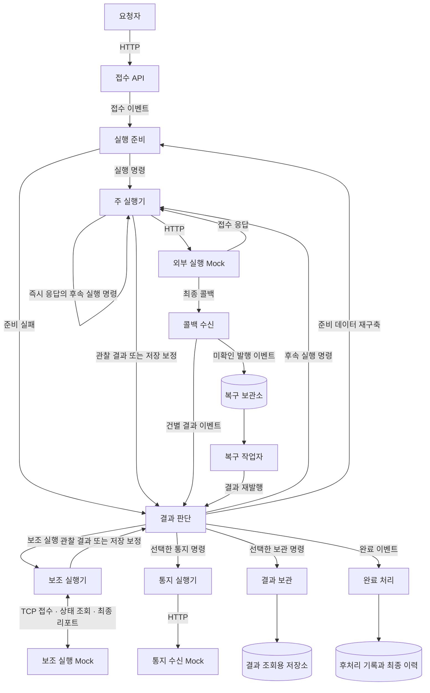

# 이벤트 기반 처리 시스템 아키텍처 적용 명세

기준: 2026-10-22. **이 문서는 적용 목표이며 현재 구현 완료를 뜻하지 않는다.** 현재 코드와의 차이, 단계별 변경과 검증은 [전환 계획](56-이벤트-기반-처리-전환-계획.md)에 기록한다. 기존 동작은 [현재 구현 상태](01-현재-구현-상태와-남은-작업.md)와 구형 경로 문서에서 구분해 확인한다.

## 목적과 적용 범위

독립 프로세스와 Kafka로 연결된 처리 구조를 유지하면서 접수 원본, 외부 실행 사실, 최종 결과의 저장 책임을 분리한다. 중복 입력과 부분 실패에도 같은 실행을 이어가며, 정상 경로의 저장소 쓰기를 줄일 때 그 상태가 담당하던 복구 기능을 함께 구현한다.

요청 내용은 불투명한 `payload`로 다룬다. 외부 시스템은 합성 HTTP/TCP Mock으로 구성하고 업무 판단은 교체 가능한 정책 포트로 분리한다. 실제 조직명, 업체 규격, 업무 전문, 운영 설정과 과거 실측 이력에서 새 계약이나 시험값을 도출하지 않는다. 기존 모듈명·코드 식별자는 역할 대응에만 사용할 수 있다.

| 구분 | 적용 원칙 |
|---|---|
| 필수 구조 | 역할별 프로세스, Kafka 경계, 저장 책임, 확정 순서, 멱등성·복구를 구현한다. |
| 합성 시험 설정 | 제한, 재시도, 시간 예산, 보관 기간과 배치 크기를 명시하며 운영 정책으로 일반화하지 않는다. |
| 별도 설계 | 기간별 사용량 영속화, 본문 참조 분리, 장기 조회, 대규모 복구는 완료로 간주하지 않는다. |

## 전체 처리 흐름

AP 사이의 명령·이벤트는 Kafka로 전달한다. HTTP/TCP/보관소로 표시한 연결은 해당 I/O를 사용한다. 최종 결과는 **통지 또는 결과 보관 중 하나와 완료 이벤트**로 구성한다. 완료 처리와 선택된 전달 소비자의 실행 순서는 가정하지 않는다. 외부 접수 응답과 최종 결과도 다른 사건이다.

## 역할과 저장 책임

| 역할 | 책임 | 정상 영속 쓰기 |
|---|---|---|
| 접수 API | 인증·검증, 제한·중복 검사, 원본 INSERT, 최초 Kafka ACK 확인 | 접수 원본 |
| 실행 준비 | 참조 조회, 고정 명령 구성, 준비 데이터 재구축 | 원본 진행 상태 갱신 없음 |
| 주 실행기 | 선점·응답 재사용, 외부 HTTP, 즉시 응답의 후속 실행 | 작은 실행 사실 |
| 콜백 수신 | 완료 경합 확인, 건별 사실 저장·결과 발행 | 작은 수신 사실, 필요한 복구 이벤트 |
| 결과 판단 | 현재 시도와 사실 대조, 후속·보조·최종 판단 | 정상 DynamoDB 쓰기 없음; 저장 보정만 예외 |
| 보조 실행기 | TCP 접수·상태 조회·최종 리포트 구분 | 작은 접수 사실과 최종 리포트 사실 |
| 복구 작업자 | 미확인 콜백 발행의 임대·재발행 | 복구 항목의 임대·진행 정보 |
| 통지 실행기 | 고정된 최종 명령의 외부 전달 | Redis 성공 표시 |
| 결과 보관 | 조회용 결과의 독립 보존 | 관계형 DB 불변 결과 행 |
| 완료 처리 | 독립 후처리·이력, 완료 표시, 확인된 삭제 | 관계형 DB 기록, Redis 완료 표시, 처리 데이터 삭제 |

업무 AP는 독립 실행 가능한 모듈로 유지한다. 공통 라이브러리는 값 객체, 계약과 공통 포트를 제공하며 다른 AP의 업무 메서드를 직접 호출하지 않는다. Mock·부하 도구는 업무 AP와 분리한다. 같은 기능의 여러 외부 대상은 실행기 코드/JAR 하나와 대상별 설정·소비 그룹·인스턴스를 사용한다. 작은 기능이나 예약 작업마다 AP·패키지를 추가하지 않는다.

| 저장 대상 | 내용과 보존 원칙 |
|---|---|
| DynamoDB 접수 원본 | 고정 요청·초기 실행 정보. 정상 INSERT 한 번이며 단계 진행 상태를 누적 UPDATE하지 않는다. |
| DynamoDB 단계 사실 | HTTP 관찰, 콜백, TCP 접수·최종 리포트. 작은 항목을 조건부 저장하고 같은 키의 다른 내용은 덮어쓰지 않는다. |
| DynamoDB 복구 항목 | 수신 사실은 확인됐지만 Kafka 발행이 미확인인 이벤트, 안정 ID·재시각·임대. 접수 실패 원본의 자동 발행에 사용하지 않는다. |
| Redis | 공유 제한, 선점, 준비·응답, 라우팅 결정, 완료·통지 성공. 용도별 실패 정책·절대 수명을 구분한다. |
| PostgreSQL 후처리 기록 | 합성 후처리의 멱등 기록. 고유 ID와 내용 일치를 검증하며 실제 업무 계산을 넣지 않는다. |
| PostgreSQL 최종 이력 | 고정 결과. 후처리 기록과 별도 트랜잭션이다. |
| PostgreSQL 결과 보관 | 조회용 불변 결과. 임시 원본·단계 삭제와 독립한다. |

접수 최종 실패 메타데이터는 정상 원본의 진행 UPDATE와 구분한다. Redis 진행 정보로 외부 실행 사실 전체를 대신하지 않는다.

## 식별자와 이벤트 계약

| 개념 | 요구사항 |
|---|---|
| `scopeId` | 요청 주체의 격리 범위. 조회·조건부 쓰기·중복 확인에 함께 검증한다. |
| `requestKey` | 요청자 제공 식별자. 내부 실행 ID와 구분한다. |
| `executionId` | 접수된 실행의 내부 ID. 재발행·재소비에서 유지한다. |
| `operationId` | 외부 호출·결과 전달 명령 ID. 같은 명령의 재처리에서 유지한다. |
| `attempt` | 이전·후속 실행을 구분한다. 단순 재소비로 증가시키지 않는다. |
| `schemaVersion` | 형식과 의미의 버전. 미지원 버전은 부작용 전에 거절한다. |
| `contentDigest` | 같은 ID의 내용 일치 검증. 고정 직렬화 규칙과 정책·명령 버전을 포함한 해시 계약을 사용한다. |
| `expiresAt` | 새 외부 실행을 시작할 수 있는 기한이다. |
| `retainUntil` | 중복 방지·응답·준비 데이터의 절대 보관 기한. 재처리로 연장하지 않는다. |

이벤트 종류에 필요한 필드만 전달한다. 접수 시 아직 없는 명령 ID나 발생하지 않은 최종 결과를 채우지 않는다. 실행 단위 Kafka key는 `executionId`다. HTTP 콜백 배열도 건별 Kafka 레코드로 나누며 로그 추적 ID를 배치 key로 사용하지 않는다. 같은 key라도 다른 토픽과 외부 콜백의 전체 순서는 보장되지 않는다.

합성 Mock은 실행·명령·시도를 구분해 콜백한다. 대응 식별자가 없는 실제 외부 연동의 오래된 콜백을 완전히 구분할 수 있다고 가정하지 않는다. 직렬화의 키·숫자·문자열·null·배열 규칙과 골든 fixture, 명령·결과·사실의 안정 ID 산식은 공통 계약 단계에서 확정하고 버전으로 고정한다.

## 접수 API

순서는 **인증·검증 → Redis 처리율 → 사용량 → 요청 중복 → 내부 실행 생성 → 원본 조건부 INSERT → Kafka 발행·ACK → 성공 응답**이다. 정상 접수 성공은 원본 저장과 Broker ACK를 모두 확인한 상태다.

- 공유 처리율은 Token Bucket이며 용량·보충률로 유휴 후 버스트도 제한한다. 프로세스 내부 동시 실행 제한은 별도다.
- 정상 거절과 저장소 가용성 오류를 구분한다. 설정된 가용성 우회는 내부 결함·손상 상태까지 허용하지 않으며 선점·완료 가드에 적용하지 않는다.
- 원본 INSERT가 미확인이면 최초 발행·성공 응답으로 진행하지 않는다. 응답 유실 뒤 일관 조회로 같은 원본이 확인되는 경우를 구분한다.
- Kafka 재발행은 같은 ID·내용으로 제한된 횟수만 수행한다. 중간 불명 뒤 ACK 확인 시 성공하며 성공 표시용 원본 UPDATE를 추가하지 않는다.
- 최종 발행 실패/불명은 원본을 보존하고 실패 기록을 시도한다. 그 기록도 미확인이면 미확정으로 남긴다. 이 경로에서 추가 자동 발행을 시작하지 않는다.
- 실패 응답은 Broker에 이벤트가 없다는 증거가 아니다. 늦은 ACK나 이미 들어간 이벤트의 후속 처리를 시험한다. 중복 재요청도 이 경계를 우회하는 무제한 자동 발행 통로가 되어서는 안 된다.

원본 INSERT는 접수 단계의 책임이다. 실행기가 외부 호출 직전에 DynamoDB 예약 상태를 쓰지 않는 조건과 혼동하지 않는다. 성공 응답은 기존 합의대로 HTTP 200이며 합성 응답 형식은 계약 시험으로 고정한다.

## 실행 준비와 재구축

참조 데이터는 Redis 우선이며 miss/조회 가용성 오류에는 관계형 DB로 대체 조회한다. 정상 부재, 손상 데이터와 DB 장애를 구분한다. 정상 부재의 선택은 합성 정책이며 DB 장애는 결과 경로의 기술 실패로 전달하고 무한 재소비로 조회를 반복하지 않는다.

준비 AP는 고정 명령을 Kafka로 전달한다. 실행기 진입에서 준비 데이터·초기 진행을 Redis에 보관하며 원본에 준비 상태를 반복 갱신하지 않는다. 준비 보관 기한은 중복 방지 기한과 맞춘다.

준비 유실 시 원본·단계 사실을 확인한 후 준비 AP의 **명령 구성 기능만** 재사용한다. 최초 검사 전체를 반복하거나 현재 설정으로 기존 명령을 바꾸지 않는다. 명령/사실에는 재구축에 필요한 고정 입력·참조 snapshot·정책 버전 또는 검증 가능한 참조가 있어야 한다. 보관된 증거로 복원할 수 없으면 임의 재구성·외부 실행을 중단하는 경계로 남긴다.

## 주 실행기와 저장 보정

순서는 **명령·기한 확인 → 실행별 직렬화 → 동시 작업·회로 차단 → Redis 선점/응답 재사용 → HTTP → 작은 사실 저장**이다.

- 외부 호출 직전에 DynamoDB 예약 행, 원본 허가 UPDATE, 진행 UPDATE를 추가하지 않는다.
- Redis 선점에 성공한 새 명령만 외부를 호출한다. 보관 응답은 재사용한다. 미확정 선점만 남으면 외부 호출 여부를 추정해 재실행하지 않는다.
- 응답을 Redis에 보관하고 작은 실행 사실을 조건부 저장한다. 접수 성공 응답만으로 최종 성공을 만들지 않는다.
- 즉시 응답의 후속 실행은 실행기가 대상 실행 토픽에 직접 발행한다. 콜백 근거의 후속 실행은 결과 판단 AP가 발행한다. 분류·대상·새 시도 허가는 합성 정책으로 고정한다.
- 사실 저장이 끝내 미확인이면 고정된 사실의 저장 보정 이벤트를 만든다. 보정은 외부 재호출이 아니다.
- 보정과 업무 결과가 함께 필요하면 같은 결과 파티션에서 보정이 먼저 보이도록 같은 Kafka 트랜잭션에 넣는다.
- 과부하는 동시 수·회로 차단·소비 일시 정지·제한 대기로 제어하며 접수 처리율 카운터를 다시 소모하지 않는다.

Redis·HTTP·DynamoDB는 원자적 작업이 아니다. 외부 성공 뒤 종료, 응답 보관 실패와 보관 유실을 각각 시험한다. 외부 멱등성 계약 없이 외부 부작용의 정확히 한 번 실행을 보장하지 않는다.

## 콜백 수신과 발행 복구

요청 전체 형식·크기를 먼저 확인한다. 건별 순서는 **완료 선조회 → 수신 사실 조건부 저장 → 완료 재조회 → 결과 발행**이다.

- 동일 사실은 기존 내용 확인 후 재발행할 수 있다. 같은 키의 상충 사실은 최초 내용을 보존하며 scope 불일치·손상을 정상 중복으로 보지 않는다.
- 저장 중 완료됐다면 뒤늦게 생성한 해당 사실만 조건부 정리하고 재발행하지 않는다. 완료 가드 오류는 우회하지 않는다.
- 사실 저장은 확인됐으나 발행이 미확인이면 재발행할 이벤트를 복구 보관소에 남긴다. 저장 확인·보관 확인·미확인 상태를 응답에서 구분한다. 일부 성공을 전체 성공/전체 미처리로 단순화하지 않는다.
- 완료 재조회 전 종료, 조건부 정리 실패로 잔여 사실이 남을 수 있다. 보호 기한 안, 가드 유실, 기한 만료 뒤의 경계를 나눠 시험하며 해결됐다고 단정하지 않는다.

복구 작업자는 예정 시각의 항목을 임대로 선점하고 같은 ID·내용을 재발행한다. Broker ACK 뒤 발행 완료를 기록한다. ACK 뒤 기록 전 종료로 생기는 중복은 결과 소비자가 처리한다. 간격·임대·보존은 합성 설정이다. 큰 데이터량의 예정 시각 인덱스·분할 처리는 별도 검증하며 전체 Scan의 대규모 적합성을 가정하지 않는다. **콜백 복구와 접수 API의 최종 발행 실패 원본 자동 재발행을 합치지 않는다.**

## 결과 판단

현재 시도와 실제 사실을 대조해 후속 실행·보조 실행·최종 결과를 선택한다. **정상 DynamoDB 쓰기는 0회**다. 진행·라우팅 결정은 Redis에 보관하고 Kafka 확정 뒤 커밋 완료 힌트를 기록한다.

- 원본·준비 명령은 외부 실행 사실이 아니다. 사실보다 먼저 온 콜백은 제한 재조회와 보정 복구로 확인한다.
- 결과 뒤 보정이 오는 역전도 처리한다. 보정 선행 복구가 업무 이벤트를 건너뛰거나 offset을 앞당기면 안 된다.
- 보정은 고정 사실만 멱등 저장하며 외부 호출·새 업무 결과·최종 통지를 만들지 않는다. 완료 뒤 사실을 재생성하지 않도록 가드를 확인한다.
- 준비가 있으면 실행기로 직접 명령을 보낸다. 없으면 원본·사실을 확인한 뒤 준비 AP에 재구축을 요청한다.
- 오래된 결과는 이미 고른 경로를 되돌리지 않는다. 같은 결정의 재처리는 같은 출력 ID와 내용을 만든다.
- 최종 결과는 선택한 전달 명령 하나와 완료 이벤트를 함께 만든다. 정상 판단을 원본이나 별도 DynamoDB 판단 행에 반복 저장하지 않는다.

Redis 유실 시 원본·사실로 복원 가능한지 확인한다. 근거 부족·상충에는 임의 성공/실패/새 실행을 만들지 않는다. 결정 유실과 보관 기한 이후 입력은 별도 검증 경계다.

## Kafka 확정과 동시성

Kafka 입력으로 Kafka 출력을 만드는 구간은 **출력과 해당 입력 offset을 같은 Kafka 트랜잭션으로 확정**한다. 개별 ACK 뒤 offset만 따로 확정하는 방식으로 대체하지 않는다. 출력 소비자는 `read_committed`를 사용한다. DB·Redis·HTTP까지 포함한 분산 트랜잭션이라고 해석하지 않는다. 최초 원본/발행, 외부 호출/사실, SQL/offset은 각각 재처리 계약을 갖는다.

1. 같은 `executionId`의 외부 작업은 poll을 넘어 직렬화하고 다른 실행만 제한 병렬 처리한다.
2. 실행·대기·완료 후 미커밋 작업을 모두 메모리 상한에 포함한다.
3. 파티션별 연속 완료된 prefix까지만 출력/offset을 확정한다. 뒤 작업이 앞 미완료를 건너뛰지 않는다.
4. Consumer와 Producer 트랜잭션 제어는 소유 스레드에서 수행하고 작업 중 poll/heartbeat를 유지한다.
5. 재할당·취소·종료 뒤 늦은 응답은 새 소유권의 출력·offset을 확정하지 못한다.
6. 커밋 응답 불명은 추정 abort/재발행으로 반복하지 않는다. 중단·재초기화 뒤 확정 offset을 기준으로 복구한다.

## 최종 통지·결과 보관

최종 명령은 대상, 안정 ID와 고정 결과를 포함해 원본·단계 삭제 뒤에도 독립 처리할 수 있어야 한다. 통지와 결과 보관은 최종 결과마다 배타적으로 선택한다.

통지는 **성공 표시 확인 → HTTP·응답 종료 확인 → Redis 성공 표시 → offset** 순서다. 성공 표시 전 장애에는 중복 호출이 가능하다. 안정 멱등 키와 수신 Mock의 중복 계약을 검증하고 Redis 조회 오류를 성공으로 처리하지 않는다. 합성 성공 코드·재시도·최종 실패 정책을 명시한다.

결과 보관은 불변 행 INSERT 또는 기존 내용 대조 뒤 **DB commit → offset** 순서다. 재소비로 결과나 조회 상태를 초기화하지 않는다. 조회 API·조회 이력 상세는 별도 설계다.

## 완료와 삭제

1. 실행 ID와 고정 결과로 합성 후처리 기록을 독립 DB 트랜잭션에 저장/내용 대조한다.
2. 다른 DB 트랜잭션으로 최종 이력을 저장/내용 대조한다.
3. Redis 완료 표시를 남기며 재처리로 수명을 연장하지 않는다.
4. 단계 사실을 모두 삭제하고 남은 항목이 없는지 확인한다.
5. scope·실행 ID를 대조해 원본을 조건부 삭제한다.
6. 앞 단계 확인 뒤에만 입력 offset을 확정한다.

실패/불명 뒤 후속 단계를 진행하지 않는다. 재시작은 확인된 기록을 대조하고 남은 처리부터 잇는다. 이력 저장 뒤 offset을 확정하고 삭제를 별도 대기열에 넘기는 구조는 이 계약과 다르다. TTL은 명시 삭제·완료 판단을 대신하지 않는다. 최종 이력·조회 결과·통지 명령은 임시 데이터 삭제의 대상이 아니다. 서로 다른 저장소 간 경합·유실도 시험한다.

## TCP 보조 실행

독립 보조 실행기와 Mock은 접수, 상태 조회, 최종 리포트를 구분한다. 순서는 **명령 검증 → Redis 선점 → TCP 접수/기존 상태 조회 → 최종 리포트 → 접수·리포트 사실 → 결과 발행**이다. 명확한 접수 거절은 리포트 없이 거절 사실로 끝낼 수 있다.

ACK 유실에는 같은 명령의 상태를 조회하며 새 접수를 임의 반복하지 않는다. 상태 조회 근거까지 유실되면 결과 생성·재실행을 승인하지 않는다. 저장 실패는 사실 보정으로 분리한다. 접수 ACK를 최종 성공으로 간주하지 않으며, 최종 리포트 또는 명확한 거절 뒤에만 최종 전달·완료를 생성한다.

## 합성 정책·시험값의 경계

정책 포트는 참조 부재 해석, 즉시 HTTP 응답 분류, 후속/보조 실행 허가, 최종 전달 선택, 합성 후처리를 분리한다. 기존 외부 오류 코드·전문·업무 계산을 새 정책의 기본값으로 가져오지 않는다. 미확정은 성공·실패와 별개 상태로 다룬다.

구체적인 POC 설정 초안과 변경 기록은 [전환 계획의 합성 시험 설정](56-이벤트-기반-처리-전환-계획.md#5-합성-시험-설정-초안)에서 관리한다. 값 확정은 계약 구현의 일부이며 현재 실행 설정을 변경했다는 뜻이 아니다.

## 검증과 성능 판정

빌드, 단위/계약, 실제 로컬 인프라 통합, 부하/장애 결과를 나눠 기록한다. 아래는 **실행할 시험 목록**이며 기존 시험 통과를 새 계약 통과로 간주하지 않는다.

| 시험 | 필수 확인 |
|---|---|
| 정상 접수·완료 | 원본·외부 실행·배타적 전달·이력·삭제가 같은 실행으로 연결된다. |
| 원본 저장 미확인 | 확인 전 최초 Kafka 발행·성공 응답이 없다. |
| 최초 ACK 지연/유실 | 같은 ID·내용의 제한 재시도와 최종 불명 뒤 자동 추가 발행 부재. |
| 제한 장애 | 정상 거절/가용성 우회/손상/내부 결함을 구분하고 가드에는 우회가 없다. |
| 외부 호출 뒤 사실 저장 실패 | 외부 재호출 없이 고정 사실만 보정한다. |
| 선점 직후 종료·응답 보관 실패 | 미확정 선점에서 임의 재실행하지 않는다. |
| 사실보다 빠른 콜백·결과보다 늦은 보정 | 제한 대기·보정으로 사실을 확인하며 업무 offset을 건너뛰지 않는다. |
| 중복/상충/scope 불일치 | 같은 내용만 재처리하고 기존 사실을 덮어쓰지 않는다. |
| 이전 시도 늦은 결과 | 이미 선택한 후속·최종 결과를 되돌리지 않는다. |
| 준비 유실 | 고정 자료로 명령 구성만 복원하고 증거 부족은 중단한다. |
| Kafka 커밋 응답 불명 | 소유자 중단·재초기화·확정 offset 복구; 추정 abort/재발행 부재. |
| 완료 순서 역전·재할당·종료 | prefix, 전체 메모리 상한, 소유 스레드, 늦은 작업 무효화를 지킨다. |
| 완료 처리 각 단계에서 종료 | 독립 SQL 기록·가드·삭제를 내용 일치 확인 후 이어간다. |
| 완료 뒤 콜백/보정 | 유효 가드 아래 사실 재생성·새 최종 전달이 없다. 가드 유실/만료는 별도 경계다. |
| 원본 삭제 뒤 전달 | 고정 명령만으로 통지/결과 보관이 되며 양쪽 동시 실행은 없다. |
| TCP ACK 유실·지연 리포트 | 상태 조회로 잇고 ACK만으로 완료하지 않는다. |
| Redis 유실/만료 | 복원 가능과 근거 부족을 구분하고 재처리로 절대 기한을 연장하지 않는다. |

각 시험은 코드 버전·설정·입력 수·기대/실제 부작용 수·남은 데이터를 대조한다. 전환 단계와 장애 시험 게이트는 전환 계획에 연결한다.

성능은 접수 TPS와 최종 완료 TPS를 따로 측정한다. AP 처리량을 더하지 않으며 입력 창·잔여 완료·lag·지연 분포를 구분한다. 실행당 DynamoDB 논리 호출/SDK 시도/조건 실패, Redis 왕복, SQL/Kafka commit을 기록한다. 큐·연결·외부·저장소 대기와 실제 레코드 평균 ms를 관측하고 TPS의 역수를 처리 시간으로 쓰지 않는다.

정상 접수 원본 INSERT 1회, 정상 결과 판단 DynamoDB 쓰기 0회, 작은 사실의 저장 주체를 실제 계측으로 확인한다. 보정·재처리는 별도 집계한다. 같은 파티션·인스턴스·자원·payload·실패 비율·캐시 적중 조건으로 전후 비교한다. 저장 횟수를 성능 개선율로 환산하지 않고 Mock·공유 로컬 저장소의 한계도 기록한다. 이 저장소의 전체 목표 10,000 TPS는 접수·최종 완료 각각에 적용하며 허용 지연/오류의 합성 합격 기준은 별도로 명시한다. 기존 실측 이력은 새 계약의 기준선이나 합격 근거로 이관하지 않는다.

## 별도 설계 항목

| 항목 | 남길 결정과 검증 |
|---|---|
| 기간별 사용량 | 차감 대상·기간 경계·영속 근거·불명/우회 사용량·중복 없는 재집계·Redis 전환 |
| 원본 객체 저장소 분리 | 수신 바이트·해시·선저장·참조·조회 실패·보존·고아 정리 |
| 불변 공통 내용 공유 | 공통/실행별 데이터·직렬화·참조 수명·마지막 참조 종료 |
| 장기 결과·조회 | 보관 밖 콜백·조회/재조회·임시 데이터 삭제 후 근거 |
| 대규모 복구 | 예정 인덱스·분할·임대·장기 실패 격리·클러스터 키 배치 |

기술적 가능성, 임시 선택과 구현 완료를 구분한다. 기존 만료·기간 설정을 새 사용량 정책으로 재정의하지 않는다. 인증·외부 실행·후처리의 구체 규격은 합성 계약에만 명시한다.

## 적용과 결과 제출

첫 작업은 역할 대응과 단계별 계획이다. 이후 **공통 계약 → 접수 → 핵심 처리 → 완료·전달 → 보조·복구 → 부하·확장** 순서로 적용하고 관련 장애 게이트를 통과한 뒤 다음 단계로 간다. 선점·응답·작은 사실·보정·완료 가드가 준비되기 전에 기존 예약/판단 상태부터 삭제하지 않는다.

기존 작업은 보존하고 별도 로컬 변경 단위에서 진행한다. 형식·의미가 달라지면 Kafka/Redis 버전을 분리한다. 소비 그룹·진행 중 이벤트·데이터 소유권을 함께 전환하고 배수·중단·복귀 절차를 명시한다. 신형 자료를 구형 코드가 안전하게 읽는지 확인 없이 JAR 교체만으로 복귀하지 않는다.

제출물은 역할별 변경, 이벤트/저장 계약, 정상·실패 흐름, 실행한 검증과 미검증 범위다. 새 측정값을 채택하면 설명 문서와 해당 역할 성능 기록을 함께 갱신한다. 현재 누락과 합성 POC 가정을 구현 완료와 구분한다.
